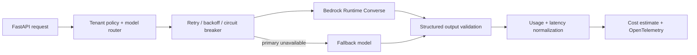

# Architecture

The production boundary is intentionally the gateway layer, not the foundation model itself. The gateway decides which model is allowed, limits retries, rejects invalid structured output, normalizes Bedrock usage metadata and records operational telemetry without storing raw prompt text.
